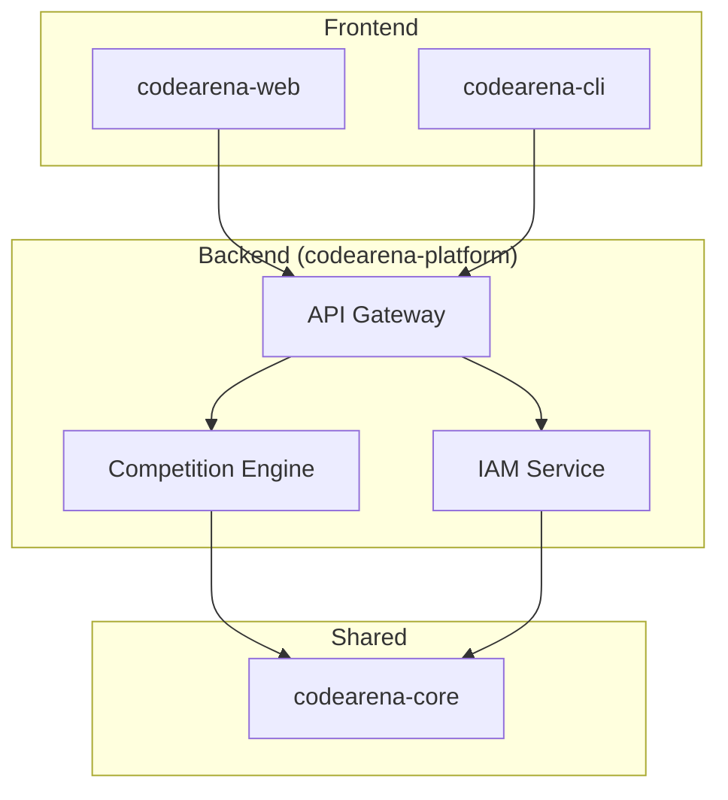

# CodeArena: The Future of Robot Combat & Educational Programming

  
  
  
  

---

## 🚀 Overview

**CodeArena** is a high-performance, deterministic robot combat platform designed to bridge the gap between gaming and education. It allows users to design, build, and program autonomous robots to compete in high-stakes tactical battles. 

Built with a cyberpunk aesthetic and a focus on visual excellence, CodeArena provides a rich 3D environment where code meets combat.

---

## 🛠️ The Ecosystem

CodeArena is organized into a modular ecosystem of repositories, ensuring scalability and clear separation of concerns:

- 🏗️ **[codearena-platform](file:///c:/Users/JacksonWendelSantosS/Project/codearena/codearena-platform)**: The backend core. A high-performance Go-based microservices architecture managing IAM, Gateways, and the Competition logic.
- ⚙️ **[codearena-core](file:///c:/Users/JacksonWendelSantosS/Project/codearena/codearena-core)**: Shared libraries, shared protocols (Protobuf), and core logic used across the entire stack.
- 🎨 **[codearena-web](file:///c:/Users/JacksonWendelSantosS/Project/codearena/codearena-web)**: The primary interface. Includes Arena Studio for building bots and the Arena Viewer for spectating battles in real-time.
- 📖 **[codearena-docs](file:///c:/Users/JacksonWendelSantosS/Project/codearena/codearena-docs)**: Centralized knowledge base, technical specs, and architecture guides.
- 💻 **[codearena-cli](file:///c:/Users/JacksonWendelSantosS/Project/codearena/codearena-cli) & [codearena-sdk](file:///c:/Users/JacksonWendelSantosS/Project/codearena/codearena-sdk)**: Essential tools for developers to integrate their bots and interact with the platform programmatically.
- 🌐 **[codearena-infra](file:///c:/Users/JacksonWendelSantosS/Project/codearena/codearena-infra)**: Infrastructure as Code (IaC) for cloud or local deployment via Docker and Kubernetes.

---

## ✨ Key Features

### 1. High-Fidelity 3D Arena
Built with **Three.js** and **React Three Fiber**, our arena features cyberpunk neon aesthetics, dynamic lighting, and orbital camera control for a truly immersive experience.

### 2. "Build-A-Bot" Factory
A modular customization system allowing users to select chassis (Scout, Sniper, Tank) and equip them with tactical modules like energy shields and overdrive pistons.

### 3. Advanced Physics & Simulation
A custom deterministic engine ensures that every collision, projectile hit, and movement is calculated with precision, providing a fair and consistent competitive environment.

### 4. Educational Portugol Transpiler
Learn logic while you fight! Our custom transpiler converts Portuguese pseudo-code into executable JavaScript, making it an ideal platform for educational settings.

### 5. Global Ranking & Matchmaking
A robust ELO-based ranking system and automatic matchmaking ensure that every battle is a fair test of skill.

---

## 🏗️ Technical Architecture

---

## 🛤️ Getting Started

To explore the individual components, visit the respective repository links above. For a comprehensive overview of the platform architecture, check out the **[codearena-docs](file:///c:/Users/JacksonWendelSantosS/Project/codearena/codearena-docs)**.

---

  <i>"Code is your weapon. The Arena is your destiny."</i>

